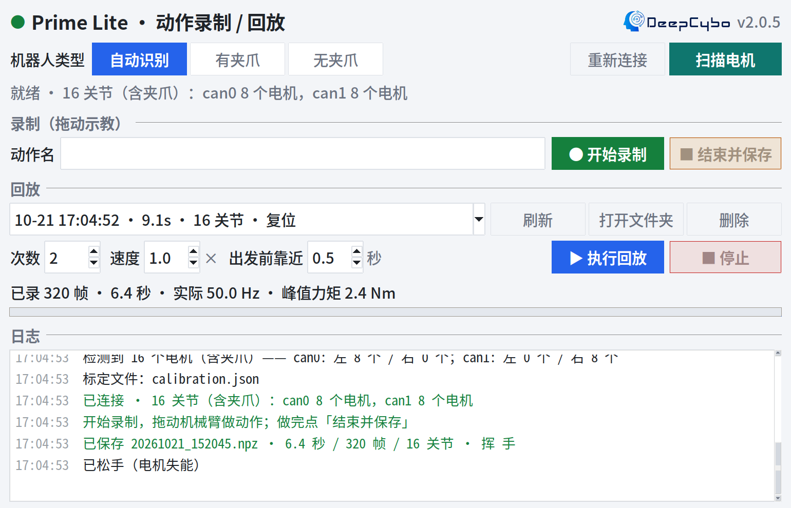

# Lite 动作录制 / 回放　`v2.0.5`

> **这是 Ubuntu / Linux 版分支。** Windows 版 → [https://github.com/TeamLite-DeepCybo/lite-record_replay/tree/windows](https://github.com/TeamLite-DeepCybo/lite-record_replay/tree/windows)　｜　版本索引 → [https://github.com/TeamLite-DeepCybo/lite-record_replay/tree/main](https://github.com/TeamLite-DeepCybo/lite-record_replay/tree/main)


Prime Lite 半身双臂机器人的**拖动示教录制 / 动作回放**工具：一个窗口、两个脚本就能用。



- **零配置**：启动时自动配置 CAN 口、自动识别左右臂在哪条总线、有没有夹爪、哪些电机在线
- **录制带时间戳**：回放按时间重采样，速度永远是对的（老版本按固定 50Hz 播放，录制一卡就会走形）
- **关节按名字对齐**：14 / 16 关节的录制可以互相回放，缺的关节保持不动
- **回放原封不动**：录制了什么位置就发什么，不做任何限位裁剪
- **重上电安全**：先原地变硬、再以 ≤0.4 rad/s 靠近首帧；姿态读数离谱时直接拒绝
- **异常必松手**：任何异常都会先阻尼 0.3 秒再失能，不会把电机留在使能状态

---

## 快速开始

```bash
./install.sh    # 一键安装（新机器跑一次，装 python3-tk / numpy / robstride-dynamics）
./start.sh      # 一键启动
```

启动后等它扫完电机，直接点「开始录制」即可，**不需要改任何代码**。

也可以带参数启动：

```bash
./start.sh --channels can2,can1      # 手动指定左右臂 CAN 口（默认自动识别）
./start.sh --robot no_gripper        # 强制按"无夹爪"（默认 auto / 可填 gripper）
./start.sh --version                 # 查看版本
```

---

## 界面

| 区域 | 内容 |
|---|---|
| **标题栏** | 状态圆点（灰=未连接 / 绿=就绪 / 橙=录制中 / 蓝=回放中）+ 标题 + 右上角公司 logo 与版本号 |
| **机器人** | 机型三选一（自动识别 / 有夹爪 / 无夹爪）+ 右侧「重新连接」「扫描电机」；下一行是状态摘要 |
| **录制** | 动作名（可留空）+「开始录制」+「结束并保存」 |
| **回放** | 第一行：动作下拉框 +「刷新 / 打开文件夹 / 删除」；第二行：次数、速度、出发前靠近 + 右对齐的「执行回放」「停止」 |
| **状态 + 日志** | 实时帧数/频率/峰值力矩、进度条，以及带时间戳、分颜色的日志（绿=成功、橙=警告、红=错误） |

动作按钮按用途配色，一眼能分清：

| 按钮 | 颜色 | 色值 |
|---|---|---|
| 扫描电机 | 青 | `#0f766e` |
| 开始录制 | 绿 | `#15803d` |
| 结束并保存 | 琥珀 | `#b45309` |
| 执行回放 | 蓝 | `#2563eb` |
| 停止 | 红 | `#c62828` |

快捷键：`Esc` 随时停止，`F5` 刷新动作列表。

### 录一段动作

1. 手臂会先软下来（力矩上限 1 Nm），可以直接用手拖；
2. 摆好后点「开始录制」，用手把动作做一遍；
3. 点「结束并保存」，自动存盘并出现在动作下拉框里。

> 录制时**没被扶住的关节会因重力缓慢下垂**，这段下垂同样会被录进去。
> 只想动一条胳膊时，请把另一条扶住或用支架托住。

### 放一段动作

1. 在下拉框选中动作（显示 时间 · 时长 · 关节数 · 动作名）；
2. 需要的话改「次数」「速度」「出发前靠近」；
3. 点「执行回放」。

**出发前靠近**：默认 0.5 秒、最小 0.5 秒。回放前用这段时间从当前姿态平缓走到动作第一帧；
姿态差得多时会自动按 0.4 rad/s 以内的安全速度延长。

---

## 机型与电机扫描

**选机型**：标题栏下面一行「机器人类型」三选一，选中的是实心蓝。

| 机型 | 含义 |
|---|---|
| **自动识别**（默认） | 扫到谁就用谁 |
| **有夹爪（16 关节）** | 按 16 个关节去扫；哪个夹爪没响应会在日志里点名 |
| **无夹爪（14 关节）** | 只认 14 个关节，不会去找夹爪 |

选定后自动重连。选了「有夹爪」但某个夹爪没接时，程序会明确列出"应该有但没响应"的关节名。

**扫描电机**：点一下弹窗列出每个电机的 ID / 型号 / 挂在哪条总线 / 在线还是未响应。
连不上、少关节、换过线之后先点这个。命令行等价：`python3 app/discover.py -r gripper`。

**重新标定**：

```bash
python3 app/calibrate.py
```

把每个关节缓慢推到上下限各一次（夹爪推到全开/全闭），按 Ctrl-C 结束，
程序算出偏移量并显示行程，确认后写入 `app/calibration.json`。
只有真正走够行程的关节才会被更新。

---

## 常见问题

**连不上 / 提示没有可用的 CAN 口**

```bash
bash app/canup.sh      # 脚本内部会自动 sudo
```

然后点界面上的「重新连接」。如果提示 `a terminal is required to read the password`，
请从终端启动本程序。

**少了一个关节 / 夹爪没检测到**

机型选「有夹爪」再点「扫描电机」，弹窗会直接标出哪个电机未响应。

**两台机器人的 CAN 口顺序不一样**

```bash
./start.sh --channels can2,can1     # 左,右
```

**回放时机械臂突然大幅运动**

看日志里这两行：

- `首帧与当前姿态相差 X.XX rad，先缓慢靠近 Y.Y 秒` —— 正常，就是靠近过程；
- 弹窗 `当前姿态和这段录制的首帧差得离谱` —— 姿态读数与标定对不上，先查读数/重新标定。

**旧版本录制的动作还在吗？**

```bash
python3 app/main.py --import-legacy /path/to/old/arm
```

会写进同一个动作列表（保留原始录制时间）。第一次启动时若列表为空、且程序旁边有旧录制，也会自动问一次。

**看看现有动作**

```bash
python3 app/main.py --list
```

---

## 目录结构

```
.
├── README.md              本文件
├── LICENSE                Apache-2.0
├── install.sh             一键安装
├── start.sh               一键启动
└── app/                   程序本体
    ├── main.py            界面入口
    ├── calibrate.py       标定
    ├── discover.py        查看 CAN 口 / 电机在线情况
    ├── canup.sh           配置 CAN 口（1 Mbps）
    ├── calibration.json   标定偏移量
    ├── requirements.txt   运行时依赖
    ├── bhl/
    │   ├── config.py      ★ 电机表（ID / 型号 / 方向 / 限位）
    │   ├── bus.py         CAN 总线封装（冲洗 + ID 过滤 + 超时预算）
    │   ├── arm.py         机械臂：批量读写、软启动、安全上下电
    │   ├── detect.py      自动识别通道 / 在线电机 / 夹爪
    │   ├── storage.py     录制文件与标定文件读写
    │   ├── motion.py      录制 / 回放纯逻辑（不含界面）
    │   └── util.py        限频器等小工具
    ├── assets/            公司 logo
    ├── docs/              界面预览图
    └── data/motions/      录制文件（*.npz，属于使用者数据，不入库）
```

录制文件是自描述的 npz：**关节名、时间戳、速度、标签、时长** 都在里面。
想改电机 ID、型号、方向或关节限位，只改 `app/bhl/config.py` 里的 `MOTORS` 表。

---

## 版本历史

| 版本 | 内容 |
|---|---|
| **v2.0.5** | 界面细化（五种按钮配色、公司 logo、版本号、布局对齐）；新增机型选择与电机扫描；修复重上电后首次回放突然大动、速度前馈抖动；整理目录、补 LICENSE |
| **v2.0.0** | 重构：4 份重复代码合成一份 + `app/bhl` 模块化；录制带时间戳、关节按名字对齐、自描述录制文件、命令行参数化 |
| **v1.2.0** | 无夹爪版本支持重复回放（`no_gripper_repeat`） |
| **v1.1.0** | 加入 CAN 通道自动识别与在线电机降级（`have_gripper_auto`） |
| **v1.0.0** | 原始录制 / 回放版本，来自上游 [Prime-Lite `record_replay`](https://github.com/pengyichen2026/Prime-Lite/tree/main/record_replay) |

各版本对应仓库里的 tag：`v1.0.0` / `v1.1.0` / `v1.2.0` / `v2.0.0` / `v2.0.5`。
v1.0.0 的原始代码由 [pengyichen2026/Prime-Lite](https://github.com/pengyichen2026/Prime-Lite) 提供，
本仓库在此基础上演进，特此致谢。

---

## 许可

本项目采用 **Apache License 2.0**，全文见 [LICENSE](LICENSE)。

- 可以自由使用、修改、商用、再分发，需保留版权与许可声明；
- 公司 logo（`app/assets/`）与"深度机智 DeepCybo"名称属商标性资产，不在代码许可范围内，二次分发请替换为你自己的品牌资源；
- 第三方依赖沿用其原许可：`robstride_dynamics`（MIT）、`numpy`（BSD-3-Clause）、`python-can`（LGPL-3.0，仅作为依赖安装，不随本仓库分发）。
